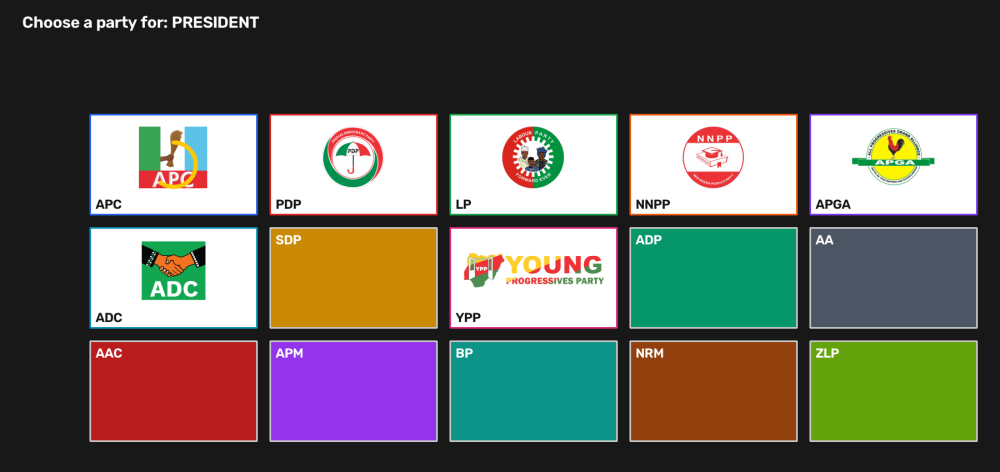

# Voter Kiosk CV -- Nigeria Biometric Voter Registration & Gesture Voting Prototype

> **⚠️ PROTOTYPE -- NOT OFFICIAL ELECTION INFRASTRUCTURE.**
> This is a portfolio/engineering prototype exploring computer-vision biometrics and
> gesture UX applied to Nigeria's election structure. It is **not** built, audited, or
> certified for real elections, is not affiliated with INEC, and must never be used to
> collect real votes. See [docs/DISCLAIMER.md](docs/DISCLAIMER.md).

A local, single-machine kiosk system with two front-ends and one shared datastore:

- **Registration desk** (`registration_app/`, Tkinter): an officer enrolls a voter --
  name/DOB/state/LGA/phone/language, a face capture with liveness (blink) detection,
  and duplicate-registration rejection via facial recognition.
- **Voting kiosk** (`kiosk_app/`, fullscreen OpenCV): fully gesture-driven, no keyboard
  or mouse. The voter picks a spoken language (English/Yoruba/Igbo/Hausa), authenticates
  by looking at the camera, then casts a ballot across 5 Nigerian offices -- President,
  Governor, Senator, House of Representatives, State House of Assembly -- by pointing at
  a party and holding (dwell-to-select), with a review screen before final submit.
- **Admin dashboard** (`admin_app/`, Tkinter, PIN-gated): live per-office/per-party
  tallies and an anonymized CSV export.

### The ballot, with real party logos



Each party card renders its real logo when one has been sourced and verified (see
[Party logos](#party-logos) below); a party with no verified logo asset falls back to a
plain color+acronym card (`SDP`, `ADP`, `AA`, `AAC`, `APM`, `BP`, `NRM`, `ZLP` above) --
never a fabricated one.

## Why it's built this way

- **Facial recognition**: [InsightFace](https://github.com/deepinsight/insightface)
  (ArcFace embeddings, `buffalo_l`) for 1:N duplicate-check and voter identification --
  chosen over `face_recognition`/dlib for materially higher accuracy (~99.86% LFW) and
  active maintenance.
- **Hand tracking**: [MediaPipe](https://ai.google.dev/edge/mediapipe) Tasks
  `HandLandmarker`, index-fingertip cursor smoothed with a One-Euro filter, dwell-to-select
  (no pinch precision required) with a mandatory two-step select-then-confirm per office,
  plus a final review screen before an atomic ballot submit -- see
  [docs/ARCHITECTURE.md](docs/ARCHITECTURE.md).
- **Voice**: [YarnGPT2](https://yarngpt.ai/api-docs) (hosted API) for Nigerian-accented
  English/Yoruba/Igbo/Hausa speech. **Pre-rendered only** -- the kiosk never calls the
  network TTS API during a live session; a one-off script renders every phrase to a
  local cache ahead of time. See [voice/README.md](voice/README.md).
- **Ballot secrecy**: votes are stored with **no voter reference of any kind** -- see
  [docs/ARCHITECTURE.md](docs/ARCHITECTURE.md#ballot-secrecy) for the schema design.

Full architecture rationale, documented simplifications vs. a real INEC ballot, and the
translation-review process live in [docs/](docs/).

### Party logos

`data/party_logos/` has real logo images for 7 of the 15 INEC-registered parties in
`data/parties_nigeria.json` (`APC`, `PDP`, `LP`, `NNPP`, `APGA`, `ADC`, `YPP`), sourced
via `scripts/fetch_party_logos.py` and rendered onto the ballot by
`hand_ui/renderer.py::draw_region`/`draw_logo`. The remaining 8 parties don't have a
verifiable, appropriately-licensed logo image available and deliberately render as a
color+acronym card instead -- **a real party's logo is never fabricated or guessed at**.

These are genuine party trademarks, reproduced at small UI-thumbnail resolution under a
claimed **nominative/fair-use** rationale (identifying a real political party by its own
public mark, in a personal, non-commercial, clearly-labeled demo) -- not a license grant
from any party, and this project's [MIT license](LICENSE) does not cover them. See
[docs/DISCLAIMER.md#party-logos](docs/DISCLAIMER.md#party-logos) for the rationale and its
limits, and [data/party_logos/ATTRIBUTION.md](data/party_logos/ATTRIBUTION.md) for the
per-logo source/license/credit. Regenerate or extend the set with:

```bash
python -m scripts.fetch_party_logos          # skips files already present
python -m scripts.fetch_party_logos --force   # re-downloads everything
```

## Quickstart

```bash
# 1. Environment + model weights
make setup                 # creates conda env `voter-kiosk-cv`, installs deps, downloads models
conda activate voter-kiosk-cv
python scripts/check_env.py   # verifies camera, GPU/CPU provider, model files

# 2. Voice prompts (needs a YarnGPT API key -- see .env.example)
cp .env.example .env       # fill in YARNGPT_API_KEY
make prerender-audio       # renders ~180 short WAV files to voice/audio_cache/
python -m voice.cache --verify-complete

# 3. Gate tests (fast, deterministic, no camera/network/model calls)
make test

# 4. Try it end to end
make seed-demo         # a few synthetic registered voters, for smoke-testing
make run-admin          # PIN set via ADMIN_PIN_HASH in .env
make run-registration   # enroll a real person via webcam
make run-kiosk          # fullscreen voting kiosk
```

Quality/model evals (real models, slower, pass-threshold gated -- not part of the fast
gate-test suite): `make eval`. Static analysis (`ruff` + `mypy`): `make lint`.

## Repo layout

```
contracts/        shared typed boundary (dataclasses/Protocols) every other module imports
data/              static reference config: parties (+logos), states, offices, phrase text (no PII)
storage/           SQLite schema + repositories (voters / votes / voted_log)
biometric/         face embedding, liveness, 1:N matching, voter ID generation
voice/             YarnGPT client (build-time only), phrase registry, audio cache, playback
hand_ui/           MediaPipe hand tracking + the pure dwell-to-select state machine
kiosk_app/         the voting kiosk: pure state machine + OpenCV screens + camera loop
registration_app/  Tkinter registration desk app
admin_app/         Tkinter PIN-gated results dashboard
scripts/           one-off setup/ops scripts (model download, env check, demo seed data, party logos)
docs/              architecture decisions, disclaimer, election-model simplifications, screenshots
```

Every concern directory has its own `tests/`, `evals/`, and `README.md`.

## Troubleshooting

- **`ModuleNotFoundError` for something unrelated to this project (e.g. `lark`),
  or pytest failing during plugin discovery** -- if this machine also has ROS2
  installed and sourced in your shell profile (`source /opt/ros/jazzy/setup.bash`
  in `.bashrc`), it sets `PYTHONPATH` globally, and conda does not isolate
  against an inherited `PYTHONPATH`. `make test`/`make eval`/etc. already clear
  it (see `Makefile`); if you run `pytest`/`python` directly instead of through
  `make`, prefix the command with `PYTHONPATH= ` (e.g. `PYTHONPATH= pytest`).

## What needs review before any real use

- Yoruba/Igbo/Hausa UI phrase translations are machine-drafted (`data/phrases/*.json`,
  `review_status: "machine_draft_unreviewed"`). See
  [docs/TRANSLATION_REVIEW_CHECKLIST.md](docs/TRANSLATION_REVIEW_CHECKLIST.md).
- Party logo trademark clearance -- the fair-use rationale in
  [docs/DISCLAIMER.md#party-logos](docs/DISCLAIMER.md#party-logos) covers this personal
  demo only. Independently clear rights for every logo before any use beyond that.

## License

Source code is [MIT-licensed](LICENSE). Party logo images in `data/party_logos/` are
real trademarks reproduced under a separate, more restrictive rationale -- see
[Party logos](#party-logos) above and
[data/party_logos/ATTRIBUTION.md](data/party_logos/ATTRIBUTION.md) -- and are **not**
covered by the MIT license.
